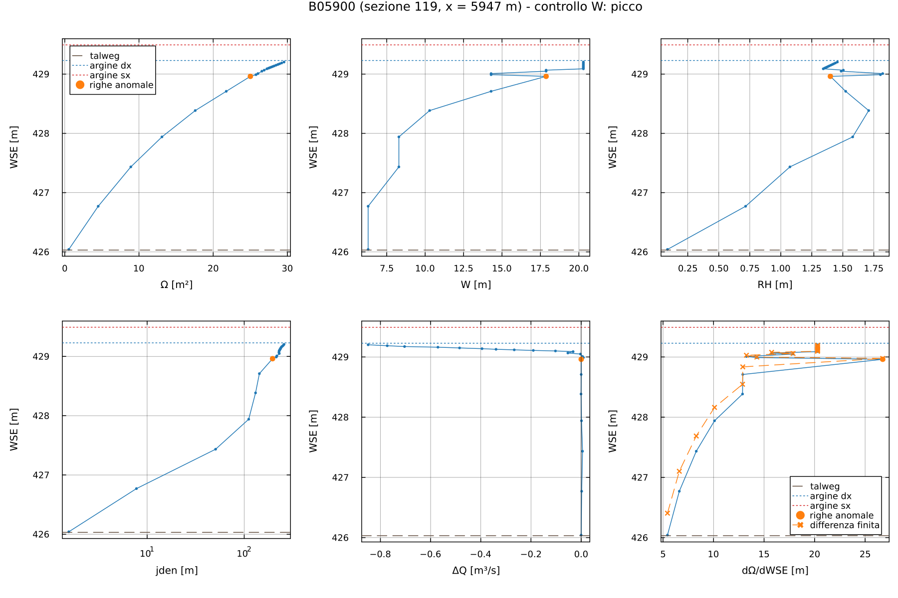
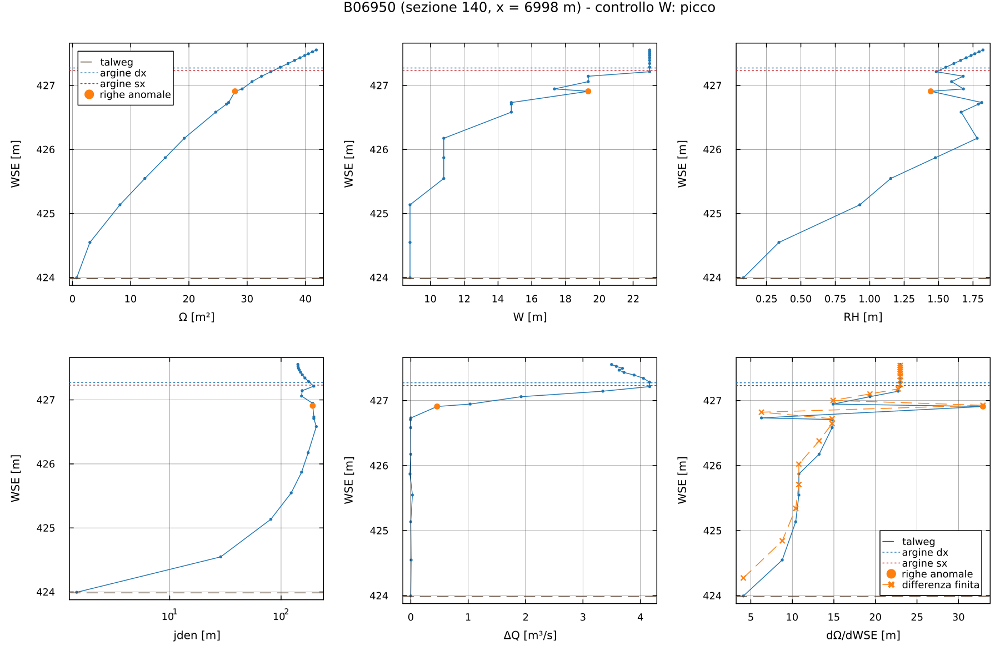
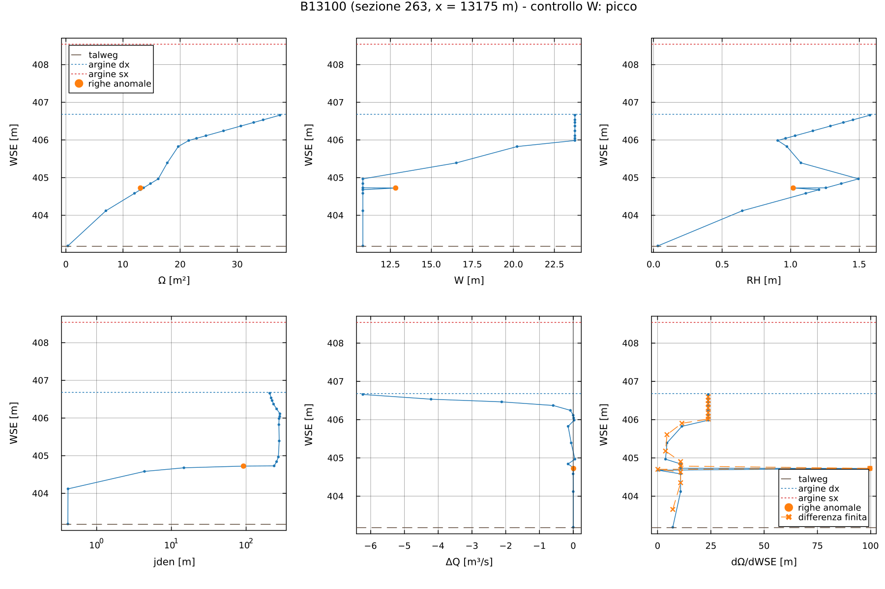
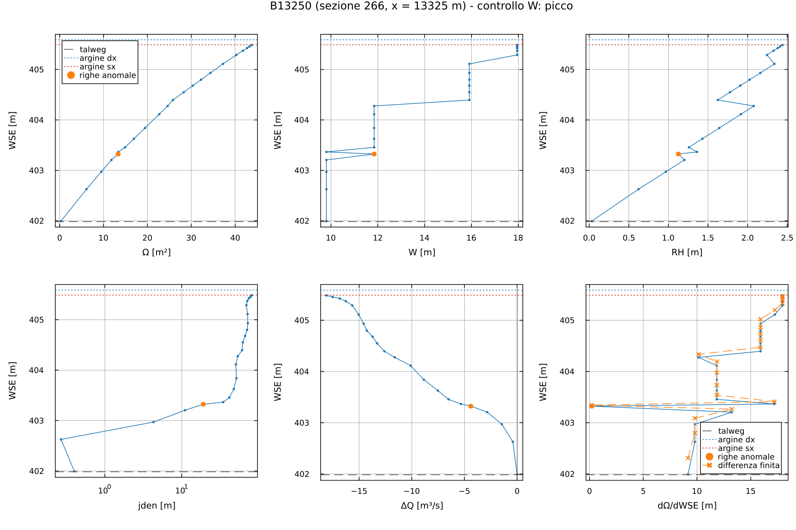
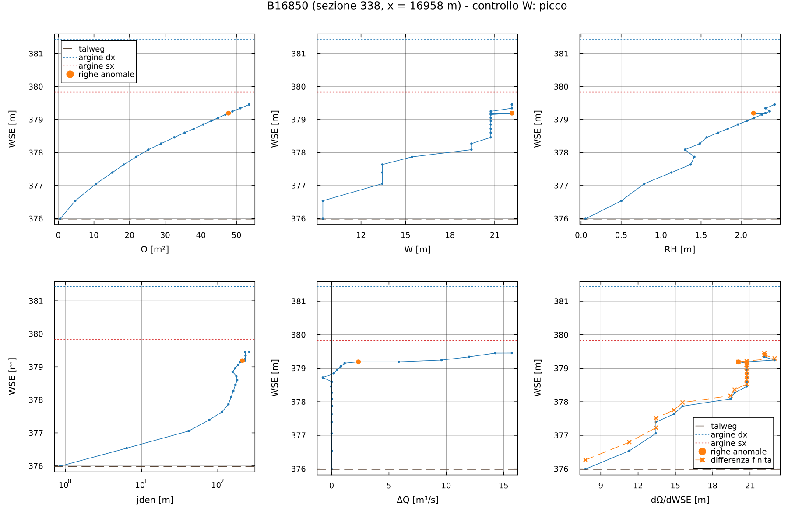

# Controllo della larghezza W - Brenta_caldonazzo_borgo

Tolleranza sul calo di W: max(0.10 m, 2 % di W). Sezioni controllate: 414.
Sezioni con anomalie: **5** (5 picchi, 0 buchi, 0 cali, 0 con sola derivata negativa).

## B05900 (sezione 119, x = 5947 m): picco

- **picco** (righe 7-7): W sale da 14.29 a 17.87 m tra WSE 428.710 e 428.962 e torna a 14.29 m a WSE 428.990 (spessore 0.281 m); W_s minima -126.4

## B06950 (sezione 140, x = 6998 m): picco

- **picco** (righe 10-10): W sale da 14.79 a 19.34 m tra WSE 426.733 e 426.909 e torna a 17.34 m a WSE 426.946 (spessore 0.213 m); W_s minima -53.8

## B13100 (sezione 263, x = 13175 m): picco

- **picco** (righe 5-5): W sale da 10.82 a 12.82 m tra WSE 404.679 e 404.724 e torna a 10.82 m a WSE 404.730 (spessore 0.051 m); W_s minima -368.4

## B13250 (sezione 266, x = 13325 m): picco

- **picco** (righe 5-5): W sale da 9.80 a 11.84 m tra WSE 403.206 e 403.324 e torna a 9.80 m a WSE 403.366 (spessore 0.159 m); W_s minima -48.6

## B16850 (sezione 338, x = 16958 m): picco

- **picco** (righe 16-16): W sale da 20.73 a 22.16 m tra WSE 379.151 e 379.192 e torna a 20.73 m a WSE 379.193 (spessore 0.042 m); W_s minima -2527.6

