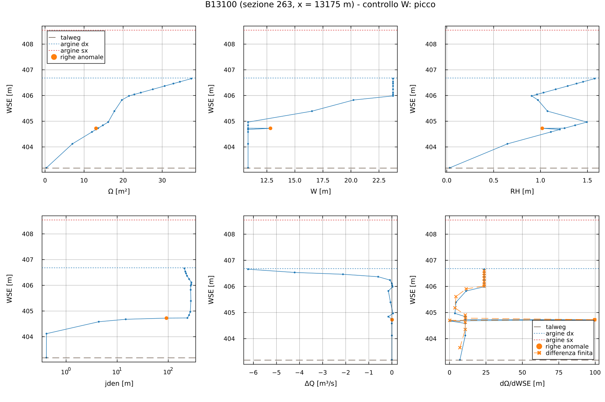

# Controllo della larghezza W - Brenta_caldonazzo_borgo

Tolleranza sul calo di W: max(0.10 m, 2 % di W). Sezioni controllate: 1.
Sezioni con anomalie: **1** (1 picchi, 0 buchi, 0 cali, 0 con sola derivata negativa).

## B13100 (sezione 263, x = 13175 m): picco

- **picco** (righe 5-5): W sale da 10.82 a 12.82 m tra WSE 404.679 e 404.724 e torna a 10.82 m a WSE 404.730 (spessore 0.051 m); W_s minima -368.4

| riga | WSE [m] | W [m] | W_s [-] |
|---|---|---|---|
| 1 | 403.187 | 10.821 | 0.00 |
| 2 | 404.120 | 10.821 | 0.00 |
| 3 | 404.583 | 10.821 | 0.00 |
| 4 | 404.679 | 10.821 | 44.29 |
| **5** | **404.724** | **12.821** | **-368.43** |
| 6 | 404.730 | 10.821 | 0.00 |
| 7 | 404.842 | 10.821 | 0.00 |
| 8 | 404.967 | 10.821 | 13.42 |
| 9 | 405.392 | 16.523 | 8.55 |
| 10 | 405.825 | 20.226 | 21.93 |
| 11 | 405.986 | 23.754 | 0.00 |
| 12 | 406.043 | 23.754 | 0.00 |
| 13 | 406.113 | 23.754 | 0.00 |
| 14 | 406.242 | 23.754 | 0.00 |
| 15 | 406.370 | 23.754 | 0.00 |
| 16 | 406.465 | 23.754 | 0.00 |
| 17 | 406.535 | 23.754 | 0.00 |
| 18 | 406.658 | 23.754 | 0.00 |

